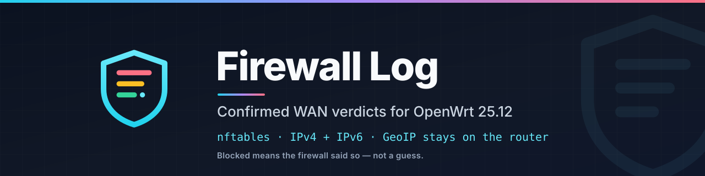

<p align="center"></p>

<h1 align="center">Firewall Log</h1>

<p align="center">
  A LuCI page for OpenWrt that shows <strong>what the firewall actually did</strong> with inbound WAN traffic,
  enriched with country and ASN data that never leaves the router.
</p>

<p align="center">
  <a href="https://github.com/softstaticx/luci-app-log/releases/latest"></a>
  
  
  
</p>

---

## Why

Every OpenWrt router already logs dropped packets, but reading `logread` is miserable: the lines are
noisy, the ring buffer is small, and "was that blocked?" is guesswork. Firewall Log turns the firewall's
own verdict into a table you can sort, filter, and keep.

- **Confirmed verdicts, not guesses.** In the default mode the log rule is injected into fw4's
  `input_wan` / `forward_wan` chains *after* every allow rule. If a row says **Blocked**, the firewall
  evaluated that packet and the zone policy dropped it.
- **Probe mode when you want visibility.** A native nftables raw-prerouting watcher can log every probe
  to your watch list, including ports behind a forward. Those rows are marked **Probe** and the page
  says the verdict was not observed.
- **No cloud, no external lookups.** Country and ASN come from a local GeoLite2 database read by a small
  C helper. The only optional external link is AbuseIPDB, off by default.
- **Honest about the past.** A 500-line ring in RAM survives page reloads, optional daily files on a
  mounted disk survive reboots, and the page can search that history in pages without loading it into the
  browser.

## Features

| | |
| --- | --- |
| **Verdicts** | Confirmed drops from the firewall chain, probes with an explicit "unverified" marker, explicit accept logs |
| **Families** | IPv4 and IPv6 in both modes; TCP SYN and UDP, plus explicit drop/allow lines |
| **GeoIP** | Local GeoLite2 Country + ASN, one process for a whole batch, 7-day browser cache, optional checksum pins and custom mirror |
| **History** | RAM ring (100–5000 lines), optional daily files with day/size retention, server-side filtering, sorting and paging |
| **Filtering** | Verdict, protocol, time window, country, ASN, port, source IP, free text, and a `key:value` search language |
| **Sharing** | Every filter is mirrored into the URL; "Copy view link" gives a bookmarkable view |
| **Files** | CSV export of the filtered view or everything loaded; settings export/import (browser + router) |
| **UI** | Inherits the active LuCI theme, works on light and dark themes, card layout on phones, keyboard-friendly |
| **Safety** | Separate read and admin ACL groups, every router write validated by a dedicated helper, `flock` around state |

## How the verdict is decided

```
                    ┌──────────────────────────────┐
   WAN packet ─────▶│ fw4: input_wan / forward_wan │
                    │  user allow rules            │──accept──▶ no row (it was allowed)
                    │  ct status dnat accept       │
                    │  ── chain-post include ──────│──▶ log "INFRA_PORT_BLOCK"  (confirmed)
                    │  zone policy drop/reject    │
                    └──────────────────────────────┘
```

| Mode | Rule location | A row means | Requires |
| --- | --- | --- | --- |
| `verdict` *(default)* | `/usr/share/nftables.d/chain-post/input_<zone>/` and `forward_<zone>/` | The packet survived every allow rule and the zone policy drops it | fw4, correct zone name |
| `probe` | own `inet` table, `prerouting` hook, priority `raw` | Somebody tried that port; the verdict is unknown | the WAN device name |

Two consequences worth knowing:

- A forwarded port that is **accepted** produces no row: `ct status dnat accept` returns before the
  include runs. You see blocked traffic, not a copy of every connection.
- Probe mode logs before filtering, so a probe to a port that is actually allowed still appears. That is
  the point of the mode, and why those rows are labelled **Probe**.

## Install

### One line (recommended)

On the router, as root:

```sh
uclient-fetch -qO- https://raw.githubusercontent.com/softstaticx/luci-app-log/main/install-online.sh | sh
```

The installer checks the OpenWrt release and APK architecture, downloads the app and its GeoIP helper,
verifies both against `SHA256SUMS`, upgrades an older install in place, and refreshes the GeoLite2
databases. Then open **Status → Firewall Log** and log in again if the menu entry is missing.

### Manual

Download from [Releases](https://github.com/softstaticx/luci-app-log/releases):

```sh
wget https://github.com/softstaticx/luci-app-log/releases/download/v4.0.3/reffix-luci-app-log-viewer-openwrt-25.12.apk
wget https://github.com/softstaticx/luci-app-log/releases/download/v4.0.3/reffix-libmaxminddb-openwrt-25.12.apk
wget https://github.com/softstaticx/luci-app-log/releases/download/v4.0.3/SHA256SUMS-openwrt-25.12.txt
sha256sum -c SHA256SUMS-openwrt-25.12.txt
apk add --allow-untrusted ./reffix-libmaxminddb-openwrt-25.12.apk ./reffix-luci-app-log-viewer-openwrt-25.12.apk
/usr/bin/flint4-geoip-update
```

### From source

```sh
# inside an OpenWrt buildroot/SDK, with this directory as a feed package
make package/luci-app-log-viewer/compile V=s
```

The package builds `src/log-viewer-geoip.c` against `libmaxminddb`; everything else is scripts and assets.

## Upgrading from 3.x

`apk add --upgrade` (or the one-line installer) is enough. On first start the new package runs
`/usr/sbin/log-viewer-migrate`, which:

- moves `log-viewer.main` (the old, never-read section) to `log-viewer.history` and keeps its values;
- adds the new `ring`, `geoip`, `mode`, `wan_zone` and `ipv6` options without touching your ports or WAN device;
- removes the iptables rules the 3.x watcher installed (the new watcher is pure nftables);
- keeps `/etc/config/infra-port-watch`, your history directory and your saved ports.

Your old rules keep logging until the watcher restarts, which `postinst` does for you.

> **ACL change:** settings, history retention and GeoIP updates now require the
> `luci-app-log-viewer-admin` group. `root` has it implicitly; a non-root operator who could change
> settings in 3.x needs to be added to that group (LuCI → System → Administration).

Deleting the package with `apk del luci-app-log-viewer` stops both services and removes the generated
nftables includes. GeoIP databases are left in place.

## Configuration

### `/etc/config/infra-port-watch`

| Option | Default | Meaning |
| --- | --- | --- |
| `enabled` | `1` | Install the watch rules |
| `mode` | `verdict` | `verdict` = confirmed drops from the firewall chain, `probe` = every probe before filtering |
| `wan_zone` | `wan` | Firewall zone whose `input_`/`forward_` chains are watched |
| `wan_interface` | `auto` | Device for probe mode; `auto` resolves the WAN `l3_device` over ubus |
| `ipv6` | `1` | Include IPv6 rules |
| `log_other_ports` | `0` | Also sample ports outside the list at a low rate |
| `ports` | see the file | Ports to log, up to 256 entries |

### `/etc/config/log-viewer`

| Option | Default | Meaning |
| --- | --- | --- |
| `history.enabled` | `0` | Write daily firewall files to `history.directory` |
| `history.directory` | `/srv/log-viewer` | Must be under `/srv`, `/mnt`, `/media`, `/etc/log-viewer` or `/tmp` |
| `history.days` | `7` | Delete daily files older than this |
| `history.max_mb` | `32` | Remove the oldest files above this size |
| `history.ring` | `500` | Lines kept in RAM (100–5000) |
| `geoip.directory` | `/usr/share/GeoIP` | Where the `.mmdb` files live; point it at USB to spare flash |
| `geoip.url` | GeoLite2 mirror | Base URL for the updater |
| `geoip.sha256_country` / `sha256_asn` | *(empty)* | Optional checksum pins; when set, a mismatch aborts the update |

Settings are normally changed in the page (Settings → WAN watch / History / Files). The CLI is available too:

```sh
/usr/sbin/log-viewer-history status
/usr/sbin/log-viewer-history configure 1 /mnt/usb/logs 30 128 1000
/usr/sbin/log-viewer-query --verdict blocked --limit 50 --sort time --order desc
/usr/bin/flint4-geoip --batch 203.0.113.7 198.51.100.9
/usr/bin/flint4-geoip-update --status
```

## Using the page

- **Stats** count matching events, confirmed blocks, probes, exposed-service hits and explicit accepts.
- **Chips** are quick filters for verdict, country, ASN and port. They stack with the toolbar filters.
- **Search** understands `port:22`, `country:cn`, `asn:telekom`, `proto:udp`, `verdict:blocked`,
  `src:203.0.113.9` and `after:1h` next to free text. Unknown tokens stay free text.
- **Click a source IP** for the drawer: events in view, ports, first/last seen, reverse DNS, copy actions,
  and "watch this port" in one click.
- **Router history** (Settings → History) pages through the ring and the daily files on the router, so a
  200 MB history never enters the browser.
- **GeoIP status** shows the age of the databases; **Update GeoIP databases** downloads, validates and
  applies them with visible progress.
- **AbuseIPDB links** are off by default. Enabling them is the only action that shares an IP with a
  third party, and the page says so.

## Privacy

- Country and ASN are computed on the router from local files.
- Reverse DNS goes to the router's configured resolver only.
- Browser history (optional) lives in IndexedDB on the machine you browse from.
- No telemetry, no analytics, no external asset hosts; flags are bundled SVGs.

## Troubleshooting

| Symptom | Check |
| --- | --- |
| No rows at all | Settings → WAN watch: is the mode `verdict` and the zone exactly the zone name in **Network → Firewall**? `nft list chain inet fw4 input_wan \| grep INFRA_PORT_BLOCK` |
| "Enabled · rules not detected" | Press **Re-apply rules** in WAN watch settings; the firewall may have been flushed with `fw4 flush` |
| Probe mode logs nothing | The WAN device must match `IN=`; try `auto` or the name shown by `logread -f` while connecting |
| GeoIP column is empty | `flint4-geoip --status`; run `flint4-geoip-update`; make sure `mmdblookup` exists. The last updater message is in `/tmp/log-viewer/geoip-update.status` |
| History does not grow | `log-viewer-history status`; the directory must be a mounted, writable path; internal flash is a bad target |
| Everything was working before a firewall change | fw4 keeps the includes, but `fw4 flush`/`firewall stop` deletes all tables. Re-apply, or reboot |

Logs: `logread | grep -E 'INFRA_PORT|log-viewer'` and `logread | grep infra-port-watch`.

## Development

```sh
node --test tests/            # 47 unit tests (JS view, ACL, installer logic)
sh tests/shell-tests.sh       # 93 integration tests for the shell side, with fake uci/nft/fw4
shellcheck -s sh -S warning root/usr/bin/* root/usr/sbin/* root/etc/init.d/*
node --check htdocs/luci-static/resources/view/log-viewer/firewall.js
```

The test stand-ins live in `tests/support/`; `tests/stub/` holds the `libmaxminddb` stub used to compile
the C helper without a real database. CI runs the same commands plus `dash -n`, `shfmt`-free shell
checks, JSON validation and a `nft -c` parse of the generated rulesets.

## License

MIT. This is a fork of [gSpotx2f/luci-app-log](https://github.com/gSpotx2f/luci-app-log); the original
application is MIT-licensed. Country flag SVGs are from [flag-icons](https://github.com/lipis/flag-icons)
(MIT). GeoLite2 data is subject to the [MaxMind EULA](https://www.maxmind.com/en/geolite2/eula).
